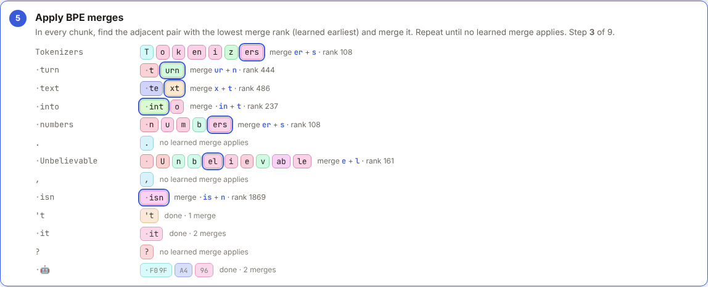
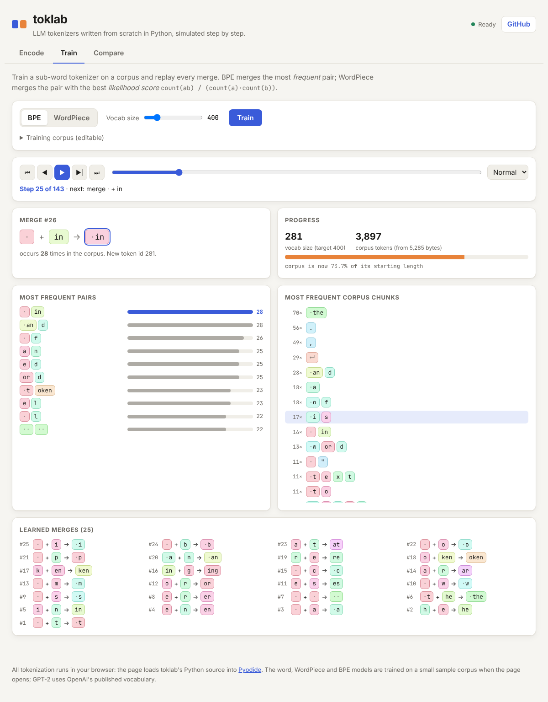
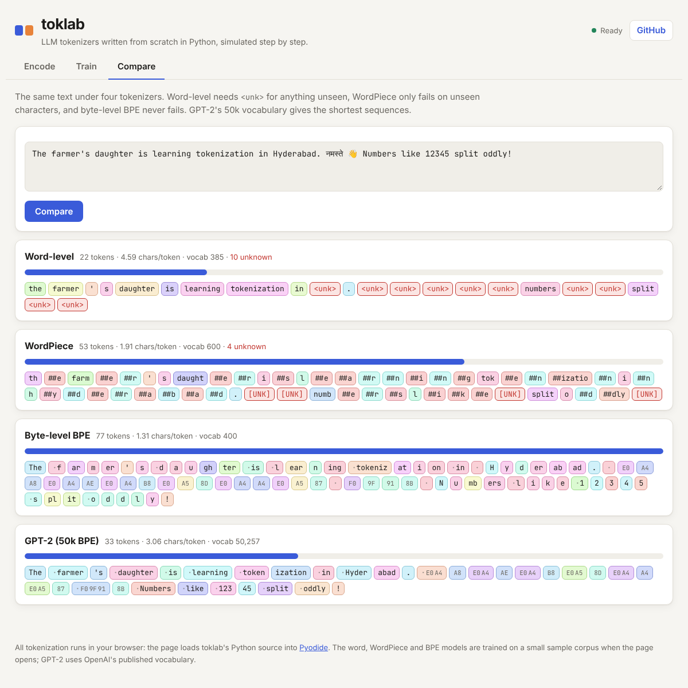

# toklab: LLM tokenizers from scratch

Word-level and sub-word level tokenizers for large language models, written from scratch in
pure Python, plus a web page that simulates every step of tokenization and training in your browser.

- **Word-level** tokenizer: vocabulary from word frequencies, `<unk>` for anything unseen
- **Byte-level BPE**: the algorithm behind GPT-2, GPT-3/4, LLaMA-3 and most open LLMs
- **WordPiece**: the algorithm behind BERT
- **GPT-2 compatible**: load OpenAI's published GPT-2 vocabulary and toklab's own BPE code
  produces *exactly* the same token ids as GPT-2 (tested against `tiktoken`)
- **No tokenizer libraries**: no `tiktoken`, `tokenizers`, `sentencepiece` or even `regex`.
  The core has zero dependencies.



## Web visualizer

**Live demo:** https://akhilnathreddy.github.io/tokenizer/ (once GitHub Pages is enabled, see below)

The page runs toklab's real Python source in the browser with [Pyodide](https://pyodide.org),
so what you see is the tested Python code, not a JavaScript re-implementation.

| Tab | What it shows |
|---|---|
| **Encode** | Type text and step through the pipeline: input → normalize → pre-tokenize → UTF-8 bytes → merges (BPE ranks, or WordPiece longest-match) → token ids. Play, pause, step or scrub. |
| **Train** | Train BPE or WordPiece on an editable corpus and replay every merge: the candidate pairs and their counts or scores, how the most frequent words are segmented, the learned merges, and how much shorter the corpus gets. |
| **Compare** | The same text under word-level, WordPiece, BPE and GPT-2: token counts, `<unk>`s, characters per token. |





Run it locally:

```bash
pip install -e .
```

```bash
toklab serve
```

Then open http://localhost:8000.

## Install

```bash
git clone https://github.com/akhilnathreddy/tokenizer.git
```

```bash
cd tokenizer && pip install -e ".[dev]"
```

Python 3.10+ and nothing else. `regex` and `tiktoken` are only used by optional cross-check tests.

## Python usage

```python
from toklab import ByteLevelBPE, WordPiece, WordTokenizer

corpus = open("data/corpus.txt").read()

# Byte-level BPE
bpe = ByteLevelBPE.train(corpus, vocab_size=1000)  # stops at 712 on this tiny corpus
ids = bpe.encode("Tokenization is unbelievable!")
bpe.tokenize("Tokenization is unbelievable!")
# ['T', 'oken', 'ization', 'Ġis', 'Ġun', 'believ', 'able', '!']
assert bpe.decode(ids) == "Tokenization is unbelievable!"    # lossless

# GPT-2's real vocabulary, applied by toklab's own code
gpt2 = ByteLevelBPE.from_gpt2_files("data/gpt2/encoder.json", "data/gpt2/vocab.bpe")
gpt2.encode("Hello world")          # [15496, 995], same as GPT-2

# WordPiece (BERT style)
wp = WordPiece.train(corpus, vocab_size=1000)
wp.tokenize("replaying")            # ['rep', '##l', '##ay', '##ing']

# Word level
word = WordTokenizer.train(corpus, vocab_size=2000)
word.tokenize("The zebra sat")      # ['the', '<unk>', 'sat']

# Every stage, as JSON-friendly data (this is what the web page renders)
trace = bpe.encode_trace("Hello world")

# Save / load
bpe.save("bpe.json")
from toklab import load
bpe = load("bpe.json")
bpe.save_gpt2("my_tokenizer/")      # encoder.json + vocab.bpe, GPT-2 format
```

## Command line

```bash
toklab train data/corpus.txt --model bpe --vocab-size 1000 -o bpe.json
```

```bash
toklab encode -m bpe.json "Hello world"
```

```bash
toklab encode --gpt2 "Hello world" --trace
```

```bash
toklab decode --gpt2 15496 995
```

```bash
toklab compare "Tokenizers split text into pieces 🤖"
```

`toklab compare` output (models trained on the 5 KB sample corpus):

```
word       vocab=385    tokens=6    unk=1
           tokenizers | split | text | into | pieces | <unk>

wordpiece  vocab=600    tokens=20   unk=1
           tok | ##e | ##n | ##iz | ##e | ##r | ##s | split | t | ##e | ##xt | i | ##n | ##to | pi | ##e | ##c | ##e | ##s | [UNK]

bpe        vocab=600    tokens=13   unk=0
           T | oken | iz | ers | Ġsplit | Ġtext | Ġinto | Ġpieces | Ġ | ð | Ł | ¤ | ĸ

gpt2       vocab=50257  tokens=9    unk=0
           Token | izers | Ġsplit | Ġtext | Ġinto | Ġpieces | ĠðŁ | ¤ | ĸ
```

The emoji shows the difference: word-level and WordPiece have never seen it, while byte-level BPE
falls back to its four UTF-8 bytes.

## How the algorithms work

### Pipeline

Every tokenizer runs the same stages:

1. **Normalize**: Unicode normalization (NFC/NFKC), optional lowercasing and accent stripping.
   Byte-level BPE skips this so that decoding gives back the exact input.
2. **Pre-tokenize**: split into rough chunks so merges never cross word boundaries.
   BPE uses GPT-2's regex; word-level and WordPiece split on whitespace and punctuation.
3. **Model**: turn each chunk into tokens (lookup, BPE merges, or WordPiece matching).
4. **Ids**: map tokens to integers.

### Word-level (`src/toklab/word.py`)

Count words in the corpus and keep the most frequent ones. Simple, but every unseen word becomes
`<unk>`, the vocabulary grows without bound, and whitespace is lost.

### Byte-level BPE (`src/toklab/bpe.py`)

**Training:** start with 256 tokens, one per byte, so any text can be encoded. Count every
adjacent pair of tokens across the corpus, merge the most frequent pair into a new token, record
the merge, and repeat until the vocabulary is big enough. toklab keeps per-pair counts and an index
of which words contain each pair, with a lazy max-heap, so each merge only touches affected words.

**Encoding:** split the chunk into bytes, then repeatedly merge the adjacent pair with the lowest
rank (the earliest-learned merge) until no learned merge applies.

**Bytes as text:** vocab files store bytes as printable characters with GPT-2's byte→unicode map,
which is why a leading space appears as `Ġ` and a newline as `Ċ`.

### GPT-2 pre-tokenizer (`src/toklab/pretokenize.py`)

GPT-2 splits text with
`'s|'t|'re|'ve|'m|'ll|'d| ?\p{L}+| ?\p{N}+| ?[^\s\p{L}\p{N}]+|\s+(?!\S)|\s+`.
Python's built-in `re` has no `\p{L}` / `\p{N}`, so toklab implements it as a hand-written scanner
over `unicodedata` categories that tries the same alternatives in the same order. Fuzz tests check
it against the real regex.

### WordPiece (`src/toklab/wordpiece.py`)

**Training:** start from characters (`##` marks a character that continues a word), and merge the
pair with the highest score `count(ab) / (count(a) × count(b))`, which favours pairs whose parts
rarely appear apart. **Encoding:** greedy longest-match-first; if any part of a word can't be
matched, the whole word becomes `[UNK]`.

## Correctness

```bash
pytest
```

- 70+ tests: round trips, special tokens, save/load, training invariants (merge counts never increase,
  replaying training gives the same segmentation as encoding), traces.
- `tests/test_gpt2_compat.py` loads GPT-2's vocabulary and checks toklab's ids against reference ids
  from `tiktoken` for 20 tricky inputs (contractions, emoji, CJK, Devanagari, Telugu, code, odd
  whitespace, `<|endoftext|>`) and for the whole sample corpus. Regenerate the fixture with
  `python scripts/make_gpt2_fixture.py`.

## Project layout

```
src/toklab/
  normalize.py     Unicode normalization
  pretokenize.py   GPT-2 regex scanner + word splitter
  byte_unicode.py  GPT-2 byte <-> printable character map
  word.py          word-level tokenizer
  bpe.py           byte-level BPE (train / encode / decode / GPT-2 files)
  wordpiece.py     WordPiece
  viz.py           JSON API used by the web page
  site.py          builds the static site
  cli.py           `toklab` command
web/               visualizer (HTML/CSS/JS, runs toklab via Pyodide)
data/corpus.txt    small sample training corpus
data/gpt2/         GPT-2 encoder.json + vocab.bpe (OpenAI, Modified MIT)
tests/             pytest suite
```

## Deploying the visualizer

`.github/workflows/pages.yml` builds the site and publishes it on every push to the default branch.
Enable it once in **Settings → Pages → Build and deployment → Source: GitHub Actions**.

## License

MIT for toklab's code. The GPT-2 vocabulary files in `data/gpt2/` are © OpenAI under their
Modified MIT license (see `data/gpt2/LICENSE`).
